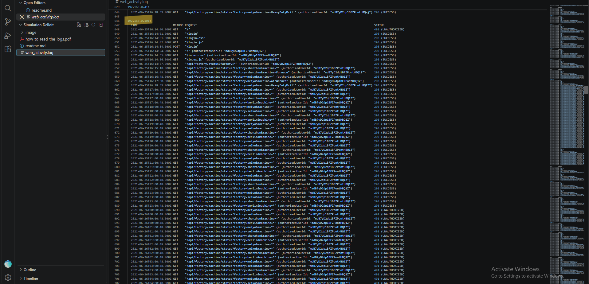
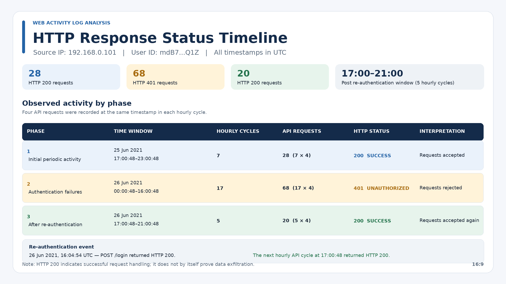
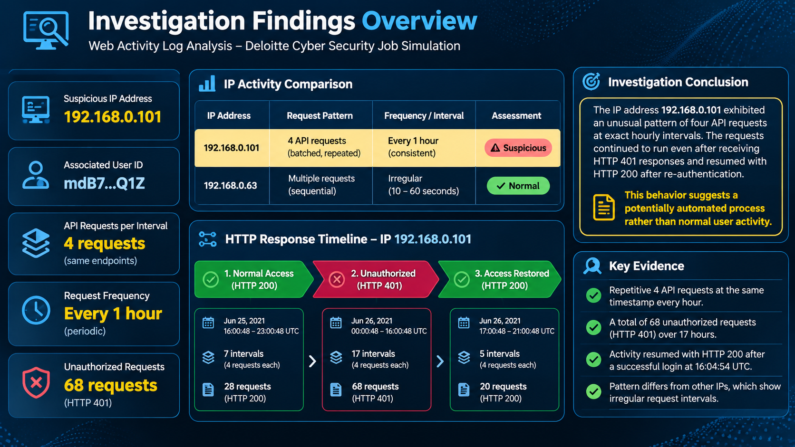

# Deloitte Cyber Security Job Simulation: Web Activity Log Analysis

**Difficulty:** Introductory  
**Organization:** Deloitte Australia  
**Simulation Provider:** Forage  
**Category:** Cybersecurity | Log Analysis | Incident Investigation

---

## 1. Project Overview

This project documents an introductory cybersecurity job simulation focused on investigating suspicious user activity within an internal web-based production status dashboard.

The investigation involved reviewing web activity logs, understanding HTTP requests and response codes, analyzing API request patterns, and identifying unusual user behavior that could indicate a potential security issue.

The objective was to assess the suspected security breach and identify evidence that could help determine the source of the suspicious activity.

## 2. Scenario

Daikibo Industrials, a manufacturing company, experienced the public disclosure of sensitive company information. At the same time, a production issue caused its assembly lines to stop, disrupting its supply chain.

The company suspected that its internal production status dashboard might have been compromised.

As part of the cybersecurity team, the investigation focused on examining web activity logs to identify suspicious requests and determine whether the alleged breach could have originated directly from the internet without access to Daikibo's VPN.

## 3. Investigation Objectives

The simulation involved two primary objectives:

**Objective 1 — Network Access Assessment**
- Assess whether an attacker could have accessed the internal status dashboard directly from the public internet without VPN access.
- Understand the internal network context provided in the simulation.

**Objective 2 — Web Activity Log Analysis**
- Inspect web activity logs to identify suspicious user requests.
- Understand the normal sequence of dashboard navigation and API requests.
- Identify unusual or repetitive API request patterns.
- Correlate timestamps, IP addresses, and authorized user IDs to investigate suspicious activity.

## 4. Tools & Resources

| Tool / Resource | Purpose |
|---|---|
| Visual Studio Code | Visually inspect and analyze web activity logs |
| Web Log Analysis Guide (PDF) | Understand log structure and normal web request sequences |
| Web Activity Log | Source data for the investigation |

The investigation was conducted through manual log inspection and comparative analysis.

## 5. Investigation Methodology

The following approach was used during the investigation:

**Phase 1 — Understanding Log Structure**

Reviewed the provided documentation to understand the main log fields:

- IP Address
- Timestamp
- HTTP Method
- Request URI
- HTTP Status Code
- Authorized User ID

**Phase 2 — Establishing Normal Activity**

Examined the expected user navigation sequence:

1. Initial dashboard access.
2. Login page and required resources.
3. Successful login.
4. Dashboard resource loading.
5. API requests to retrieve factory and machine status.

This sequence provided a reference for distinguishing normal navigation from unusual activity.

**Phase 3 — IP Address and User Activity Analysis**

Grouped log entries by source IP address and reviewed the associated user activity.

Compared request sequences, timestamps, API endpoints, and user identifiers across different IP addresses.

**Phase 4 — API Request Pattern Analysis**

Examined the frequency and timing of API requests to identify unusual repetitive behavior.

Particular attention was given to requests occurring at exact hourly intervals, as the simulation documentation stated that the dashboard did not support continuous polling.

**Phase 5 — Authentication and HTTP Status Analysis**

Compared HTTP response codes before and after successful user authentication.

Investigated whether repeated API requests continued after authentication failures and whether their behavior changed following re-authentication.

## 6. Findings & Evidence

### Finding 1 — Unusual Periodic API Requests

During the investigation, an unusual API request pattern was identified from the following source:

| Indicator | Observation |
|---|---|
| Source IP | `192.168.0.101` |
| Associated User ID | `mdB7...Q1Z` (partially redacted) |
| Request Frequency | Every 1 hour |
| Requests per Interval | 4 API requests |
| API Endpoints | Factory machine status endpoints |
| Initial Response | HTTP 200 |
| Subsequent Response | HTTP 401 |

The same four API requests were repeatedly issued at the exact same timestamp every hour.

This pattern differed from the irregular API request intervals observed in other user activity samples.

### Finding 2 — Repeated Authentication Failures

On June 26, 2021, the four hourly API requests began returning HTTP 401 (Unauthorized).

This behavior continued from 00:00:48 UTC through 16:00:48 UTC.

The requests continued at the same hourly intervals despite the authentication failures.

**Observed activity:**

- 17 hourly intervals.
- 4 API requests per interval.
- 68 unsuccessful API requests in total.
- All requests returned HTTP 401.

### Finding 3 — Activity Following Re-authentication

The same IP address subsequently performed another successful login.

At 16:04:54 UTC on June 26, 2021, the POST `/login` request returned HTTP 200.

Following re-authentication, the same four-request hourly pattern resumed.

However, the requests once again returned HTTP 200 (Success).

This behavior indicates that the periodic API request mechanism continued operating across the authentication failure period.

### Investigation Assessment

Considering the exact hourly intervals and the simulation's documentation stating that continuous polling was not available in the dashboard, the observed activity suggests a potentially automated process.

The recurring API requests and their associated user identifier represent suspicious activity requiring further investigation.

However, the available web activity logs alone do not establish the identity of the process responsible or prove malicious intent.

## 7. Conclusion & Limitations

The investigation identified an unusual pattern of recurring API requests associated with IP address `192.168.0.101` and a consistent authorized user identifier.

The behavior was characterized by:

- Four API requests occurring at exact hourly intervals.
- Repeated HTTP 401 responses after the authentication context became invalid.
- Continued requests despite authentication failures.
- Successful API responses following re-authentication.

The observed behavior is consistent with an automated API request mechanism and differs from the expected manual dashboard refresh behavior described in the simulation.

Regarding network access, the simulation describes the dashboard as an internal intranet application and the logged IP addresses as internal Daikibo network addresses. This supports an internal network access context, although the supplied web logs alone cannot establish whether a particular connection originated through an office network or VPN.

**Investigation Limitations**

The available dataset did not include:

- VPN connection logs.
- Firewall or proxy logs.
- Endpoint process or scheduled-task information.
- Authentication token or session lifecycle details.
- API response payloads or data export records.

Therefore, the investigation does not independently establish the human actor, exact automation mechanism, or whether sensitive information was successfully exfiltrated.

## 8. Skills Demonstrated

- **Digital Forensics:** Examining activity records and identifying unusual behavior.
- **Computer Networking:** Understanding internal IP addresses and network access context.
- **Application Security:** Analyzing web requests, API activity, and authentication behavior.
- **Log Analysis:** Interpreting timestamps, HTTP methods, request paths, and response codes.
- **Incident Investigation:** Correlating evidence and developing investigation hypotheses.

---

**Disclaimer:** This repository documents learning activities performed as part of a virtual job simulation. It is not an actual security investigation or professional engagement with Deloitte or Daikibo Industrials.